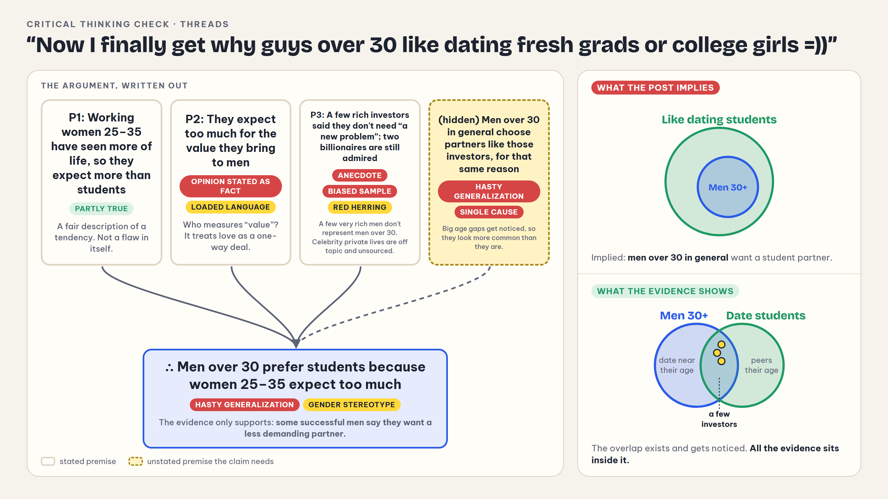
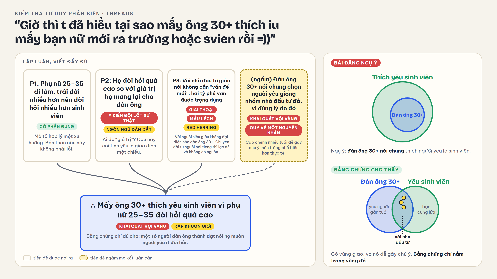

# aner-skills

Agent skills for Claude Code (and other agents that read `SKILL.md` folders).

## Skills

| Skill | What it does |
|---|---|
| [critical-thinking-viz](skills/critical-thinking-viz/SKILL.md) | Turns a claim, post or tweet into an argument map with stated and hidden premises, fallacy and bias labels, Venn diagrams and counterexample tests. Outputs an interactive HTML page (language switch, light/dark theme, map pinned beside the tests on wide screens), 16:9 PNG infographics for social replies, or both. Vietnamese + English by default. |




## Install

**As a plugin** (Claude Code):

```
/plugin marketplace add um1chc5/aner-skills
/plugin install aner-skills@aner-skills
```

**As a personal skill**: copy the skill folder into `~/.claude/skills/`:

```bash
git clone https://github.com/um1chc5/aner-skills.git
cp -r aner-skills/skills/critical-thinking-viz ~/.claude/skills/
```

## Requirements

- Node.js 18+
- Chrome or Edge for the PNG card (set `CHROME_PATH` if it is not in a standard location)

## Try it by hand

```bash
cd skills/critical-thinking-viz
node scripts/build.mjs both examples/math-subfield-cs.json ./out
```

This writes `out/page.html` and one card per language: `out/card.en.png`, `out/card.vi.png`.
